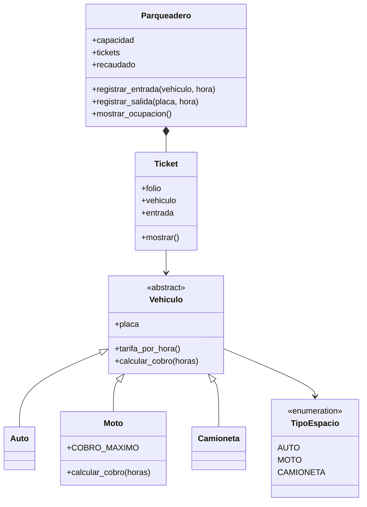

# 075 Sistema de parqueadero

Un programa que simula un día en un estacionamiento con espacios para autos,
motos y camionetas. Cada vehículo recibe un ticket al entrar con la hora de
llegada, y al salir se calcula cuánto tiempo estuvo y cuánto paga. Cada hora
o fracción se cobra completa, cada tipo de vehículo tiene su tarifa y las
motos tienen un cobro máximo. También verás qué pasa si no hay espacio, si
una placa ya está dentro o si la placa viene vacía.

Este proyecto cierra la etapa de programación orientada a objetos.

## Cómo ejecutarlo

Desde esta carpeta:

```bash
python main.py
```

En Windows también puedes usar `py main.py`, y en macOS o Linux `python3 main.py`.

## Diagrama de clases

GitHub dibuja este diagrama automáticamente a partir del texto en Mermaid.
La flecha con triángulo indica herencia y el rombo indica que una clase
contiene a otra.



## Qué vas a practicar

En este proyecto vas a juntar casi todo lo de la etapa: una clase abstracta
`Vehiculo` con tres clases hijas, una moto que sobrescribe
`calcular_cobro()` y reutiliza la del padre con `super()`, un `Enum` para
los tipos de espacio, un `@dataclass` para el ticket, excepciones propias,
anotaciones de tipo y un estacionamiento compuesto por sus tickets.

Lo nuevo es el módulo `datetime`. Un objeto `datetime` guarda un momento
exacto, y al restar dos se obtiene la duración entre ellos, de la que
`total_seconds()` te da los segundos. Con `math.ceil()` esa duración se
redondea hacia arriba para cobrar cada hora o fracción. En el ejemplo las
horas se fijan a mano para que el resultado siempre sea el mismo; en un
sistema real usarías `datetime.now()`.

Símbolos y sintaxis nuevos: el módulo `datetime`, la resta de fechas,
`total_seconds()`, `datetime.now()`, `strftime()` para dar formato a una
fecha, como `"%d/%m/%Y %H:%M"`, y `math.ceil()` para redondear hacia arriba.
